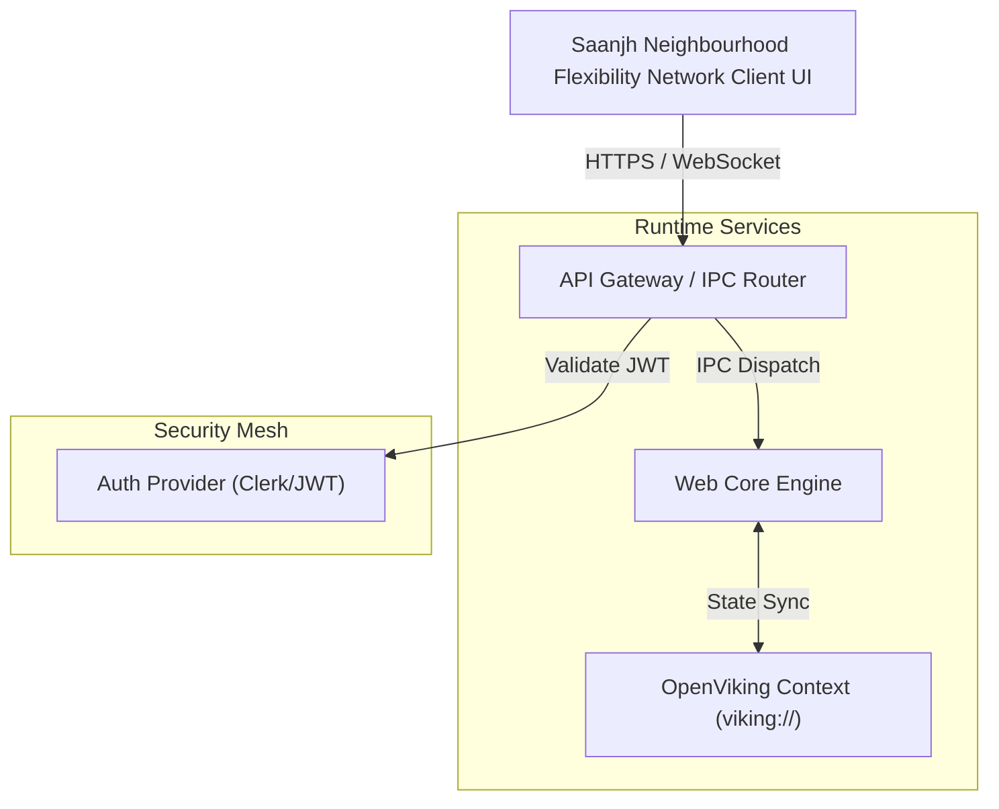

# System Architecture (Architecture.md)
## Project: Saanjh Neighbourhood Flexibility Network

### 1. Topology & Component Mesh (via ArchitectureDiagramGenerator)

### 2. Data Flow & Communication Contracts
1. **Inbound Ingestion:** Client dispatch enters through the validated API Gateway.
2. **Execution Engine:** Core coordinator orchestrates computation and dispatches tasks to local subagents.
3. **State Persistence:** Key milestones and intermediate results checkpoint to SQLite memory.
4. **Telemetry Export:** Tracing spans and performance metrics pipe to OpenTelemetry collector.
